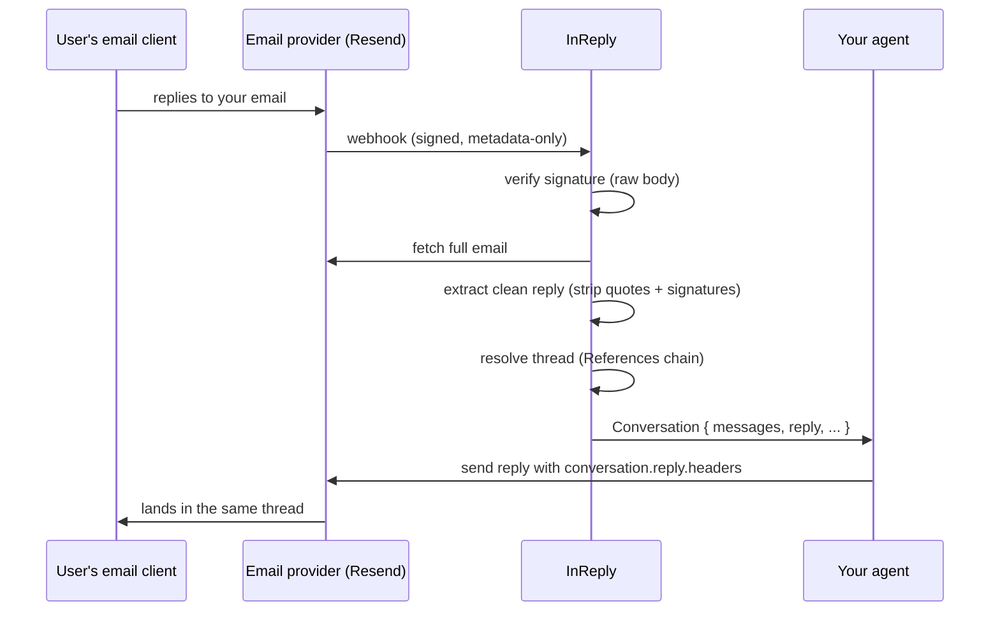

<div align="center">

# InReply

**Turn inbound email replies into resumable AI conversations.**

[](https://github.com/inreply/inreply/actions/workflows/ci.yml)
[](https://www.npmjs.com/package/inreply)
[](./LICENSE)

</div>

```ts
const conversation = await resumeConversation(request);
await myAgent.reply(conversation);
```

InReply turns inbound email replies into resumable conversations. It hides the
complexity of email parsing, thread reconstruction, and reply extraction behind
a clean, framework-agnostic API. Version 0.1 ships with first-class support for
[Resend](https://resend.com), with additional providers planned as lightweight
adapters.

Every email reply carries an `In-Reply-To` header. **InReply is the primitive
that makes you forget it exists.**

---

## The problem

Sending email is beautifully simple. _Receiving a reply_ is not. Every AI
product that converses over email rebuilds the same glue code:

<table>
<tr>
<th>Without InReply</th>
<th>With InReply</th>
</tr>
<tr>
<td>

```ts
// 1. Verify the webhook signature over the RAW body
const wh = new Webhook(process.env.WEBHOOK_SECRET);
const event = wh.verify(rawBody, {
  'webhook-id': headers['svix-id'],
  'webhook-timestamp': headers['svix-timestamp'],
  'webhook-signature': headers['svix-signature'],
});

// 2. Only some events are inbound email
if (event.type !== 'email.received') return ok();

// 3. The webhook is metadata-only - fetch the body
const { data } = await resend.emails.receiving.get(event.data.email_id);

// 4. Prefer text, fall back to converting HTML
let text = data.text ?? htmlToText(data.html);

// 5. Strip quoted history: "On Mon, Jul 13 ... wrote:",
//    "> quoted lines", "-----Original Message-----" ...
text = stripQuotedReplies(text);

// 6. Strip signatures: "-- ", "Sent from my iPhone" ...
text = stripSignatures(text);

// 7. Parse Message-ID / In-Reply-To / References
const refs = parseReferences(data.headers['references']);
const threadId = refs[0] ?? data.message_id;

// 8. Rebuild the References chain for YOUR reply,
//    normalize "Re: Re: Re:" subjects, pick reply-to...
// ... 30 more lines
```

</td>
<td>

```ts
const conversation = await resumeConversation(request);

if (!conversation) return ok();

// conversation.message.text
//   → the clean human reply
// conversation.messages
//   → chat-shaped thread history
// conversation.reply.headers
//   → correct threading, done
```

</td>
</tr>
</table>

Developers should stop thinking about webhooks, MIME, `Message-ID`, and reply
parsing. They should think about one thing: **the conversation**.

## Install

```bash
pnpm add inreply @inreply/resend
```

## Quickstart (Next.js + Resend)

```ts
// app/api/inbound/route.ts
import { createInReply, isInReplyError } from 'inreply';
import { resend } from '@inreply/resend';

const { resumeConversation } = createInReply({ provider: resend() });

export async function POST(request: Request) {
  try {
    const conversation = await resumeConversation(request);
    if (!conversation) return new Response('ok'); // delivery receipt, open, ...

    console.log(conversation.message.text); // the clean human reply

    return new Response('ok');
  } catch (error) {
    if (isInReplyError(error)) {
      return new Response(error.message, { status: error.status });
    }
    throw error;
  }
}
```

| Env var                 | Where to find it                                          |
| ----------------------- | --------------------------------------------------------- |
| `RESEND_API_KEY`        | [resend.com/api-keys](https://resend.com/api-keys)        |
| `RESEND_WEBHOOK_SECRET` | The signing secret on your webhook endpoint (`whsec_...`) |

Then point a Resend webhook for the `email.received` event at your route.
That's the whole integration.

## The `Conversation` object

```ts
{
  threadId: 'msg-1@mail.example.com',   // stable per thread, from the References chain
  subject: 'Re: Upgrade my plan',
  topic: 'Upgrade my plan',             // subject without Re:/Fwd: noise

  message: {                            // the inbound message, cleaned
    role: 'user',
    from: { email: 'customer@example.com', name: 'Customer' },
    text: 'Yes, upgrade me to Pro please!',   // quotes + signatures stripped
    original: { text: '...', html: '...' },   // untouched bodies, always preserved
    /* ... */
  },

  messages: [ /* [...history, message] - oldest first, chat-shaped */ ],

  reply: {                              // everything a threaded reply needs
    to: 'customer@example.com',
    from: 'support@yourapp.dev',
    subject: 'Re: Upgrade my plan',     // never "Re: Re: Re:"
    headers: {
      'In-Reply-To': '<msg-2@mail.example.com>',
      References: '<msg-1@mail.example.com> <msg-2@mail.example.com>',
    },
  },

  attachments: [ /* metadata */ ],
  raw: { /* the provider's full original email - escape hatch */ },
}
```

`messages` maps 1:1 to chat messages, so any AI framework consumes it in one
`.map()` - OpenAI, Anthropic, LangGraph, Mastra, or the Vercel AI SDK.

## Build an email agent

The full loop - inbound reply → AI → threaded response - with the Vercel AI SDK:

```ts
import { createInReply, InMemoryThreadStore } from 'inreply';
import { resend as resendProvider } from '@inreply/resend';
import { generateText } from 'ai';
import { openai } from '@ai-sdk/openai';
import { Resend } from 'resend';

const threadStore = new InMemoryThreadStore();
const { resumeConversation } = createInReply({
  provider: resendProvider(),
  threadStore, // optional: gives conversations memory
});
const resend = new Resend();

app.post('/webhooks/resend', async (c) => {
  const conversation = await resumeConversation(c.req.raw);
  if (!conversation) return c.text('ok');

  const { text } = await generateText({
    model: openai('gpt-5.1'),
    system: 'You are a helpful email assistant. Reply in plain text.',
    messages: conversation.messages.map((m) => ({ role: m.role, content: m.text })),
  });

  await resend.emails.send({
    from: conversation.reply.from,
    to: conversation.reply.to,
    subject: conversation.reply.subject,
    text,
    headers: conversation.reply.headers, // ← correct threading, zero thought
  });

  await threadStore.append(conversation.threadId, assistantTurn(text, conversation));
  return c.text('ok');
});
```

Runnable versions: [`examples/ai-agent`](./examples/ai-agent),
[`examples/nextjs`](./examples/nextjs), [`examples/express`](./examples/express),
[`examples/hono`](./examples/hono).

## Framework recipes

**Web `Request` (Next.js, Hono, Bun, Deno, Workers)** - pass the request
straight in. InReply reads the raw body itself, which is exactly what signature
verification needs:

```ts
const conversation = await resumeConversation(request); // Next.js route handler
const conversation = await resumeConversation(c.req.raw); // Hono
```

**Node-style (Express)** - pass `{ headers, body }` with the **raw** body:

```ts
app.post('/webhooks/resend', express.raw({ type: 'application/json' }), async (req, res) => {
  const conversation = await resumeConversation({ headers: req.headers, body: req.body });
  // ...
});
```

> ⚠️ Use `express.raw()` on the webhook route, not `express.json()`. Signatures
> are computed over the exact raw bytes - a re-serialized body will never verify.

## Conversation memory

The core is completely stateless - thread identity comes purely from
`Message-ID`/`References` headers, no database required. Add an optional
`ThreadStore` and `conversation.messages` includes history:

```ts
interface ThreadStore {
  get(threadId: string): Promise<Message[]>;
  append(threadId: string, message: Message): Promise<void>;
}
```

That's the entire interface - a Postgres adapter is ~20 lines:

```ts
const postgresStore: ThreadStore = {
  async get(threadId) {
    const { rows } = await pool.query(
      'SELECT message FROM threads WHERE thread_id = $1 ORDER BY created_at',
      [threadId],
    );
    return rows.map((r) => r.message);
  },
  async append(threadId, message) {
    await pool.query('INSERT INTO threads (thread_id, message) VALUES ($1, $2)', [
      threadId,
      message,
    ]);
  },
};
```

InReply appends inbound messages automatically and deduplicates webhook
redeliveries, so your store can stay dumb. The bundled `InMemoryThreadStore` is
perfect for development (state resets on restart - bring your own store in
production).

## How it works



## Providers

InReply solves a universal problem, so the core is provider-agnostic:

```
                 InReply
                    │
     ┌──────────────┼──────────────┐
     │              │              │
  Resend        SendGrid        Postmark
 (v0.1)        (planned)       (planned)
```

A provider implements one method:

```ts
interface InboundProvider {
  name: string;
  receive(request: NormalizedRequest): Promise<InboundEmail | null>;
}
```

Verify the webhook, hand back a normalized email (fetching the body if your
platform's webhook is metadata-only), return `null` for non-inbound events.
The core does everything else. See
[`packages/resend`](./packages/resend) for the reference implementation and
[CONTRIBUTING.md](./CONTRIBUTING.md) for a guide.

## Error handling

Everything throws a single `InReplyError` with a `code` and a suggested HTTP
`status` - and verified-but-irrelevant events return `null`, never throw:

| `code`              | `status` | Meaning                                                           |
| ------------------- | -------- | ----------------------------------------------------------------- |
| `invalid_signature` | 401      | Signature verification failed (wrong secret, or not the raw body) |
| `invalid_request`   | 400      | Missing webhook headers / malformed input                         |
| `invalid_payload`   | 400      | Event or API response didn't match the expected shape             |
| `fetch_failed`      | 502      | The provider's API errored while fetching the email               |
| `missing_config`    | 500      | Missing API key / webhook secret - thrown eagerly at startup      |

```ts
if (isInReplyError(error)) {
  return new Response(error.message, { status: error.status });
}
```

## Roadmap

- **v0.2** - `conversation.reply()` (send with threading handled, assistant turn
  stored automatically), attachment content download
- **Providers** - SendGrid, Postmark, Amazon SES
- **Stores** - Postgres, Redis/Upstash, LangGraph checkpointer

## Contributing

PRs welcome - see [CONTRIBUTING.md](./CONTRIBUTING.md). Adding a fixture for an
email client we don't strip correctly yet is the single most valuable
contribution.

## License

[MIT](./LICENSE)
