<div align="center">

# InReply

[](https://github.com/inreply/inreply/actions/workflows/ci.yml)
[](https://www.npmjs.com/package/inreply)
[](./LICENSE)

**Every AI application knows how to send emails.**

**None of them know how to continue conversations.**

</div>

Sending is one line. But when a human hits _Reply_, you're suddenly parsing
MIME, stripping `> quoted history`, deleting "Sent from my iPhone", decoding
`References` headers, and praying your response lands in the same thread.

InReply turns an inbound email reply into one clean, resumable conversation
object. It ships with first-class [Resend](https://resend.com) support, with
more providers planned as lightweight adapters.



## Before and after

<table>
<tr>
<th>Every team writes this</th>
<th>With InReply</th>
</tr>
<tr>
<td>

```ts
// verify svix signature over the RAW body
const event = new Webhook(secret).verify(rawBody, {
  'webhook-id': headers['svix-id'],
  'webhook-timestamp': headers['svix-timestamp'],
  'webhook-signature': headers['svix-signature'],
});
// ignore non-inbound events
if (event.type !== 'email.received') return ok();
// the webhook is metadata-only: fetch the body
const { data } = await resend.emails.receiving.get(event.data.email_id);
// prefer text, convert HTML, strip quotes:
// "On Mon ... wrote:", "> lines",
// "-----Original Message-----" ...
// strip signatures: "-- ", "Sent from my iPhone"
// parse Message-ID / In-Reply-To / References
// resolve the thread, rebuild the reply chain,
// normalize "Re: Re: Re:" subjects ...
// ~150 lines, different in every repo
```

</td>
<td>

```ts
const conversation = await resumeConversation(request);
```

</td>
</tr>
</table>

## Sixty seconds to running

```bash
pnpm add inreply @inreply/resend
```

```ts
// app/api/inbound/route.ts (Next.js; Hono, Express, anything works)
import { createInReply, isInReplyError } from 'inreply';
import { resend } from '@inreply/resend';

const { resumeConversation } = createInReply({ provider: resend() });

export async function POST(request: Request) {
  try {
    const conversation = await resumeConversation(request);
    if (!conversation) return new Response('ok'); // delivery receipt, open, ...

    console.log(conversation.message.text); // the clean human reply

    return new Response('ok');
  } catch (error) {
    if (isInReplyError(error)) {
      return new Response(error.message, { status: error.status });
    }
    throw error;
  }
}
```

Set `RESEND_API_KEY` and `RESEND_WEBHOOK_SECRET`, point a Resend
`email.received` webhook at the route, and reply to an email. That is the
whole integration.

## The example: an AI recruiter

One flow shows everything. An AI recruiter invites a candidate, and then
holds the entire scheduling conversation over plain email:

```ts
app.post('/webhooks/resend', async (c) => {
  const conversation = await resumeConversation(c.req.raw);
  if (!conversation) return c.text('ok');

  // The thread arrives chat-shaped. Hand it straight to the model.
  const { text } = await generateText({
    model: openai('gpt-5.1'),
    system: 'You are Ava, a recruiter at Acme, scheduling an interview.',
    messages: conversation.messages.map((m) => ({ role: m.role, content: m.text })),
  });

  // to, subject, and threading headers are pre-built. It lands in-thread.
  await resend.emails.send({ ...conversation.reply, text });
  return c.text('ok');
});
```

The candidate books an interview without ever leaving their inbox. Every
reply, no matter how many days later, resumes the same conversation with full
history. Runnable version: [`examples/ai-recruiter`](./examples/ai-recruiter).

## What your code receives

```ts
{
  threadId: 'msg-0@mail.example.com',  // stable per thread, from the References chain
  topic: 'Upgrade my plan',            // subject without Re:/Fwd: noise

  message: {
    role: 'user',
    from: { email: 'sam@example.com', name: 'Sam' },
    text: 'Tuesday 2pm works great!',  // quotes + signatures stripped
    original: { text, html },          // untouched, if you ever need it
  },

  messages: [ /* full thread, oldest first, chat-shaped */ ],

  reply: {
    to: 'sam@example.com',
    subject: 'Re: Interview invitation',           // never "Re: Re: Re:"
    headers: { 'In-Reply-To': ..., References: ... }, // correct threading, done
  },
}
```

`messages` maps 1:1 to chat messages: one `.map()` feeds OpenAI, Anthropic,
LangGraph, Mastra, or the Vercel AI SDK.

## Conversation memory

The core is stateless: thread identity comes purely from email headers, no
database required. Add a `ThreadStore` (two methods) and `messages` includes
history; a Postgres adapter is ~20 lines:

```ts
interface ThreadStore {
  get(threadId: string): Promise<Message[]>;
  append(threadId: string, message: Message): Promise<void>;
}
```

InReply appends inbound messages automatically and deduplicates webhook
redeliveries. The bundled `InMemoryThreadStore` covers development.

## Providers

InReply solves a universal problem, so the core is provider-agnostic. A
provider is one method:

```
                 InReply
                    │
     ┌──────────────┼──────────────┐
  Resend        SendGrid        Postmark
  (v0.1)        (planned)       (planned)
```

Same application code, different import. See
[CONTRIBUTING.md](./CONTRIBUTING.md) to write one.

## Errors

One error type. `code` says what happened, `status` says what to respond:

| `code`              | `status` | Meaning                                           |
| ------------------- | -------- | ------------------------------------------------- |
| `invalid_signature` | 401      | Not signed by your provider (or not the raw body) |
| `invalid_request`   | 400      | Missing webhook headers / oversized body          |
| `invalid_payload`   | 400      | Event shape mismatch                              |
| `fetch_failed`      | 502      | Provider API failed while fetching the email      |
| `missing_config`    | 500      | Missing keys, thrown eagerly at startup           |

Verified events that simply aren't inbound email return `null`, never throw.

## More

- **Framework recipes**: [Hono](./examples/hono) · [Express](./examples/express) (mind `express.raw()`) · [Next.js](./examples/nextjs)
- **Documentation site**: [`apps/docs`](./apps/docs), deploy-ready for Vercel
- **Security model**: [SECURITY.md](./SECURITY.md), including what your app must still handle

## Contributing

The single most valuable contribution: an email whose reply we clean
incorrectly, as a test fixture. See [CONTRIBUTING.md](./CONTRIBUTING.md).

## License

[MIT](./LICENSE)
